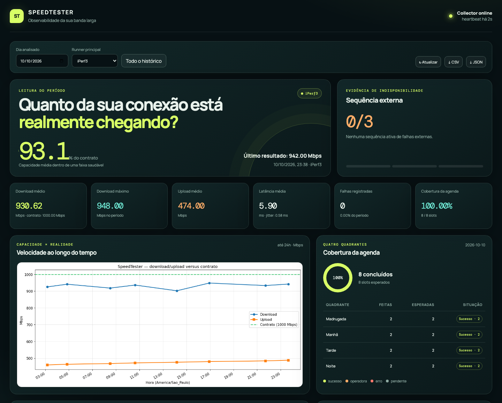
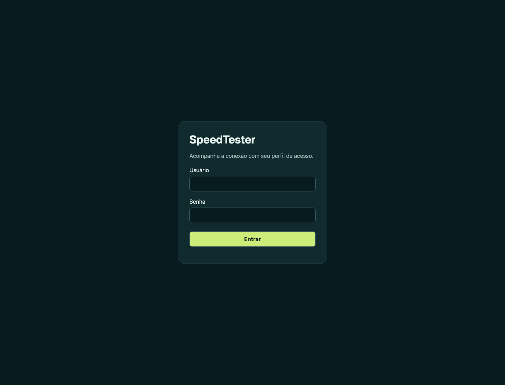

# SpeedTester Client

[](https://github.com/ecarara/SpeedTester/actions/workflows/ci.yml)
[](LICENSE)

Robô para acompanhar a qualidade da banda larga ao longo do tempo. Ele executa
testes de download, upload, latência e jitter, persiste cada observação em
SQLite e disponibiliza uma API e um dashboard web.

**Autor e mantenedor:** Edson Angelo Carara (`ecarara`)
**Repositório oficial:** <https://github.com/ecarara/SpeedTester>

> **Status:** software em evolução. A coleta contínua, o scheduler por
> quadrantes, o iPerf3 como runner principal, a persistência SQLite, a API, o
> dashboard e a classificação operacional estão implementados. Antes de usar
> os dados como evidência de SLA, valide o ambiente e mantenha uma cópia
> externa do banco.

## Instalador gráfico em desenvolvimento

A [prévia do Client gráfico](docs/desktop-client.md) inicia o suporte a Windows, Linux e macOS, com serviço independente da interface, vínculo opcional, reparo e desinstalação. Ainda não é um pacote certificado para workstations de produção; o instalador Linux publicado permanece disponível. Após aceite vigente e pareamento, a agenda ativa oito testes por dia, sempre em horários futuros; a instalação não executa um teste imediato. A consulta **Minhas medições** apresenta gráficos locais, filtros e a situação de envio ao Server, sem exigir login.

## Baixar e instalar SpeedTester

Existe um único cliente SpeedTester, nos formatos de cada sistema operacional.
Baixe o pacote em [Downloads](https://speedtester.cararalab.com.br/client).
Para instalar por terminal no Linux, baixe o
[instalador](https://github.com/ecarara/SpeedTester/releases/latest/download/install-speedtester-client.py)
e execute no diretório em que salvou o arquivo:

```bash
python3 install-speedtester-client.py
```

O instalador baixa a release estável, verifica o SHA-256 e usa o mesmo coletor
dos pacotes nativos. Confirme o fuso e a localização. Deixe o servidor vazio
para seleção automática por distância geográfica ou informe seu próprio
servidor opcional. As medições e o painel local não exigem conta.

Requisitos: Linux amd64/arm64, usuário normal com sessão systemd, Python
3.11 ou posterior com venv e iPerf3. O download sozinho não inicia medições.
Para fixar um destino, use `python3 install-speedtester-client.py --server seu-host --port 5201`.
Consulte [seleção geográfica e escolha manual](docs/server-selection.md).
O código do instalador está em [install-speedtester-client.py](install-speedtester-client.py).

Antes de autorizar, consulte o [inventário de dados enviados](https://speedtester.cararalab.com.br/data). Depois do aceite e do pareamento, Servers que anunciam `client-environment-v1` podem receber sistema operacional, distribuição, versão e arquitetura. Hostname, nome do usuário, número de série e conteúdo de arquivos pessoais não fazem parte desse registro. As métricas e o perfil da conexão continuam separados; os detalhes estão em [docs/client-environment.md](docs/client-environment.md).

## Dashboard



Captura da aplicação real com dados **inteiramente fictícios**. Nenhum banco,
IP, hostname ou credencial do ambiente interno foi usado. Veja como executar a
[demonstração local e reproduzir a captura](docs/demo.md).

## O que existe hoje

- **Collector:** scheduler contínuo que cria pelo menos dois slots aleatórios
  por quadrante, persiste o plano e executa cada slot devido.
- **Motor de medição principal:** iPerf3, com testes TCP de upload e download
  reverso, retransmissões TCP e medição complementar de qualidade ICMP.
  Ookla oficial e fast.com permanecem disponíveis para comparação. Todos os
  runners coletam, quando possível, ping mediano, jitter, latência
  mínima/máxima e perda de pacotes.
- **Persistência:** SQLite em `/data/speedtester.db` no Compose.
- **Identidade da conexão:** cada medição bem-sucedida pode persistir operadora,
  país, cidade, ASN e IP público observados; a consulta é cacheada e não
  invalida uma medição quando o serviço externo não responde.
- **API:** FastAPI para saúde, amostras, resumo, gráfico PNG e limpeza dos
  dados, comparação histórica, alertas e eventos de disponibilidade.
- **Dashboard:** gráficos SVG interativos, filtros de 7/30/90 dias, medianas e
  percentis p10/p95, cobertura de slots devidos/classificados/futuros e
  exportação completa CSV/JSON, além de atlas interativo por operadora, cidade
  e país sem expor IP público no mapa.
- **Interface:** HTML/JavaScript servido pela própria API, atualizado a cada
  10 segundos.
- **Deploy:** Docker Compose com os serviços `db`, `api`, `collector` e
  `backup`, além de `install.sh` com preflight e reinício pelo Docker.

## Documentação

- [Índice da documentação](docs/README.md)
- [Demonstração e screenshots](docs/demo.md)
- [Requisitos e regras de negócio](docs/requirements.md)
- [Arquitetura atual e arquitetura-alvo](docs/architecture.md)
- [Modelo de dados e classificação de indisponibilidade](docs/data-model.md)
- [API e exemplos](docs/api.md)
- [Métricas e gráficos](docs/analytics-and-charts.md)
- [Operação, instalação e troubleshooting](docs/operations.md)
- [Desenvolvimento](docs/development.md)
- [Referência de código](docs/code-reference.md)
- [Dependências e licenças de terceiros](docs/third-party.md)
- [Conformidade GPL e distribuição](docs/license-compliance.md)
- [Checklist de publicação no GitHub](docs/publishing.md)
- [Roadmap e critérios de aceite](docs/roadmap.md)
- [Relatório de validação no servidor](docs/validation-2026-08-26.md)

## Licença

Este projeto é distribuído sob a **GNU General Public License, versão 3 ou
posterior** (`GPL-3.0-or-later`). Consulte o texto completo em
[LICENSE](LICENSE). Ao adicionar ou distribuir novos arquivos do projeto,
preserve o aviso de copyright de Edson Angelo Carara e verifique a
compatibilidade das dependências de terceiros.

## Arquitetura atual

```text
collector ── grava ──▶ SQLite (/data/speedtester.db) ◀── lê ── api ──▶ dashboard
```

O Compose usa um volume nomeado (`db_data`) compartilhado pelo banco lógico,
API e collector. O serviço `db` é apenas um container que mantém o volume e
responde ao healthcheck; o SQLite é acessado diretamente pelos outros dois
serviços.

## Execução local

A API e o collector usam imports absolutos. Execute a partir da raiz do
repositório com `PYTHONPATH=app`; `aiohttp` está declarado em
`app/requirements.txt`.

```bash
git clone https://github.com/ecarara/SpeedTester.git
cd SpeedTester
python3 -m venv .venv
. .venv/bin/activate
python -m pip install -r app/requirements.txt

PYTHONPATH=app DB_PATH=/tmp/speedtester.db \
  .venv/bin/python -m uvicorn api.server:app --host 127.0.0.1 --port 8000
```

Em outro terminal:

```bash
PYTHONPATH=app DB_PATH=/tmp/speedtester.db \
  .venv/bin/python -m collector.collector
```

Abra <http://127.0.0.1:8000>.

## Execução com Docker

```bash
cp env.example .env
# IPERF3_SERVER vazio = seleção geográfica; preencher = servidor escolhido.
docker compose --env-file .env -f docker/compose.yaml -p speedtester up -d --build
docker compose --env-file .env -f docker/compose.yaml -p speedtester logs -f collector
```

Dashboard padrão: <http://localhost:8000>.

Requisitos: Docker com Compose v2. O destino é selecionado automaticamente
pela localização geográfica. Opcionalmente, defina `IPERF3_SERVER` e a porta
para usar um destino específico. O runner iPerf3 requer
os binários `iperf3`, `ping` e `ip` no host Linux; eles já estão na imagem do
collector. As imagens suportam Linux AMD64 e ARM64. O cliente Ookla incluído permanece
restrito a AMD64; ARM64 usa iPerf3 ou fast.com.
Configure `API_ADMIN_TOKEN` para habilitar ações administrativas e
`BANDWIDTH_CONTRACTED_MBP` para comparar a banda com seu contrato.

Instalação no servidor:

```bash
scp -r SpeedTester usuario@servidor:~/
ssh usuario@servidor
cd ~/SpeedTester
./install.sh
```

As imagens são publicadas em GHCR para AMD64/ARM64 pelo workflow
[Container images](https://github.com/ecarara/SpeedTester/actions/workflows/images.yml).
Para instalar as imagens da branch principal sem compilar:

```bash
docker compose --env-file .env -f docker/compose.yaml -p speedtester pull
docker compose --env-file .env -f docker/compose.yaml -p speedtester up -d --no-build --wait
```

Prefira `IMAGE_TAG=sha-<commit-completo>` para fixar uma revisão em produção.
Consulte [operação](docs/operations.md) para o diagnóstico de instalação,
backup externo criptografado e restauração.

## Configuração principal

| Variável | Padrão | Uso |
|---|---:|---|
| `SAMPLE_INTERVAL_SECONDS` | `1800` | compatibilidade; a agenda atual usa slots por quadrante |
| `SAMPLE_DURATION_SECONDS` | `30` | duração máxima/configurada do teste |
| `SPEEDTEST_RUNNER` | `iperf3` | runner principal do collector: `iperf3`, `ookla` ou `fast` |
| `MEASUREMENTS_PER_QUADRANT` | `2` | quantidade mínima de slots em cada quadrante |
| `SCHEDULER_LATE_TOLERANCE_SECONDS` | `900` | atraso máximo antes de marcar um slot como perdido |
| `ANOMALY_RETRY_RATIO` | `0.5` | retesta a primeira medição se o download ficar abaixo desta fração do contratado |
| `ANOMALY_RETRY_MIN_DOWNLOAD_MBPS` | vazio | limiar absoluto opcional de download para acionar o reteste |
| `MAX_BYTES` | `10000000` | teto por stream, conforme runner atual |
| `SPEEDTEST_SERVER_IDS` | `29564` | compatibilidade; não usado pelo fast.com |
| `IPERF3_SERVER` | vazio | vazio: seleção geográfica automática; preenchido: servidor escolhido |
| `IPERF3_PORT` | `5201` | porta do servidor iperf3 |
| `IPERF3_DURATION_SECONDS` | `10` | duração de cada direção do iperf3 |
| `IPERF3_PARALLEL_STREAMS` | `5` | fluxos TCP paralelos do iperf3 |
| `MEASUREMENT_TIMEOUT_SECONDS` | `60` | limite total de uma medição iPerf3; timeout é descartado e repetido como primeira tentativa |
| `BANDWIDTH_CONTRACTED_MBP` | vazio | banda contratada em Mbps; o nome contém `MBP` e deve ser preservado até uma migração |
| `ISP_LOOKUP_ENABLED` | `true` | identificação best-effort da operadora |
| `ISP_LOOKUP_TIMEOUT_SECONDS` | `5` | timeout da consulta de operadora |
| `TZ` | `America/Sao_Paulo` | timezone operacional desejado |
| `API_HOST` / `API_PORT` | `0.0.0.0` / `8000` | bind interno da API |
| `API_BIND_ADDRESS` | `127.0.0.1` | interface do host publicada pelo Docker |
| `API_REQUIRE_LOGIN` | `true` | exige login também em leituras e exportações |
| `API_VIEWER_PASSWORD_HASH` | vazio | hash scrypt do perfil visualizador |
| `API_ADMIN_PASSWORD_HASH` | vazio | hash scrypt do administrador; usa token existente quando vazio |
| `API_ADMIN_TOKEN` | vazio | token das operações administrativas; obrigatório quando `API_REQUIRE_ADMIN_TOKEN=true` |
| `API_REQUIRE_ADMIN_TOKEN` | `true` | falha fechada: bloqueia operações administrativas sem token |
| `API_RATE_LIMIT_PER_MINUTE` | `120` | limite de requisições por cliente nas rotas `/api/*` |

Para o significado completo das variáveis, limitações e comandos operacionais,
consulte [operations.md](docs/operations.md).

## Limitações importantes conhecidas

1. Falta de energia deve ser registrada manualmente; sem essa justificativa,
   um slot vencido vira `MISSED_UNKNOWN`.
2. O collector registra uma origem preliminar (`INTERNAL`, `OPERATOR` ou
   `MEASUREMENT`) baseada em probes, mas a atribuição não é prova de SLA e a
   classificação automática não substitui evidência contratual.
3. O downtime considera eventos de indisponibilidade registrados; sem
   evento explícito, não há minutos de queda comprovados. A fonte automática de
   energia e os critérios formais de SLA são evoluções futuras.
4. O gráfico PNG legado mantém a janela de 24 horas; o dashboard interativo
   mostra períodos de 7/30/90 dias e distribuições por quadrante.
5. Quando configurado o contrato, uma primeira medição com download abaixo do
   limiar de anomalia é descartada e substituída por um único reteste imediato.
   A segunda medição é a representativa, mesmo que também fique abaixo do
   limiar. A primeira fica auditada em `measurement_attempts` e não entra nas estatísticas.

Essas limitações são parte do diagnóstico; os requisitos e o desenho para
resolvê-las estão em [requirements.md](docs/requirements.md) e
[architecture.md](docs/architecture.md).

## Desenvolvimento e qualidade

```bash
python -m pip install -r requirements-dev.txt
PYTHONPATH=app python -m unittest discover -s tests -v
python -m compileall -q app
python scripts/check_docs.py
git diff --check
```

Com `make` instalado, a verificação completa pode ser executada com `make check`.
Ela também verifica a presença dos metadados GPL e dos avisos SPDX nos arquivos
de código. O workflow do GitHub executa essas verificações em cada pull request.
Veja
[CONTRIBUTING.md](CONTRIBUTING.md) e [docs/development.md](docs/development.md).

## Estrutura

```text
.
├── app/
│   ├── api/server.py                 # FastAPI e geração do gráfico atual
│   ├── api/network_map.py            # agregação geográfica sem IP público
│   ├── api/store.py                  # schema e acesso SQLite
│   ├── collector/collector.py        # laço atual de coleta
│   ├── collector/iperf3_runner.py    # runner principal
│   ├── collector/runner_dispatch.py  # seleção de runner
│   ├── dashboard/index.html          # dashboard responsivo
│   ├── dashboard/network-map.js      # atlas SVG interativo
│   └── shared/settings.py            # configuração por ambiente
├── docker/
│   ├── api/Dockerfile
│   ├── collector/Dockerfile
│   ├── backup/Dockerfile
│   └── compose.yaml
├── docs/                             # documentação funcional e técnica
├── tests/                            # testes de domínio e runners
├── scripts/                          # backup e utilitários
├── .github/                          # CI, templates e Dependabot
├── SECURITY.md
├── CONTRIBUTING.md
├── env.example
└── install.sh
```

### Acesso ao dashboard

O dashboard exige login por padrão. Configure uma senha administrativa em
`API_ADMIN_PASSWORD_HASH` ou use o `API_ADMIN_TOKEN` já configurado para entrar
como `admin`. O perfil `viewer` usa `API_VIEWER_PASSWORD_HASH` e só consulta e
exporta. Gere hashes com `python3 scripts/password_hash.py`; preserve as aspas
simples no `.env`. Consulte [operação](docs/operations.md) para configuração,
expiração de sessões e deploy automático. `API_REQUIRE_LOGIN=false` é reservado
para demonstração local com dados fictícios.




## Community integration foundation

The public `speedtester-client-protocol` package provides typed metric observations, signed grants/receipts, DPoP proofs and an encrypted authoritative queue. [Protocol v1](contracts/server-v1/README.md) is exercised by public consumer tests without access to private Server sources.

`CommunityAgent` obtains and starts an authorized attempt before invoking its runner callback, sends metric observations separately and verifies every receipt before acknowledging the queue. Missing measurements remain explicit states. Headless pairing, automatic token rotation and a guided Linux amd64/arm64 installer are implemented in the integration branch. See the [community installation guide](docs/community-client.md). The community service is separate from the standalone collector and requires a configured Server; it is not enabled in staging by default.
