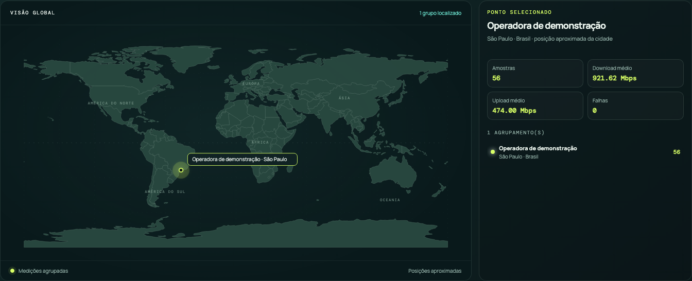

# Métricas e gráficos

## Métricas de velocidade

Para cada dia e quadrante, calcular apenas sobre medições `SUCCESS`:

- quantidade de medições;
- média e mediana de download/upload;
- mínimo, máximo e p95;
- ping mediano e jitter médio;
- latência mínima/máxima, perda de pacotes e retransmissões TCP;
- percentual da banda contratada;
- quantidade de resultados abaixo de um limiar configurável.

Médias de dias com slot perdido não devem tratar o slot como `0 Mbps`.

O coletor aplica um reteste único antes da persistência quando a primeira
medição de download atende à regra de anomalia documentada em
[requirements.md](requirements.md). Assim, os indicadores não contam a
primeira tentativa descartada; o valor salvo é o resultado representativo do
slot.

## Cobertura da agenda

```text
coverage_pct = slots_concluidos / slots_esperados × 100
```

Mostrar cobertura total e por quadrante. Um dia com falta de energia pode ter
100% dos slots restantes classificados, mas também deve mostrar quantos slots
foram marcados `POWER_OUTAGE`; não deve parecer um dia sem observações.

## Indisponibilidade

Somar a duração dos intervalos de indisponibilidade, unindo eventos sobrepostos
antes do cálculo para não contar duas vezes. Separar:

- minutos atribuídos à energia;
- minutos atribuídos à operadora;
- minutos atribuídos à infraestrutura interna;
- minutos desconhecidos;
- tempo total monitorado.

Não usar os intervalos entre duas amostras como downtime: um intervalo grande
sem amostra pode ser apenas um processo desligado.

## Gráficos necessários

### 1. Velocidade versus contrato

Gráfico de linhas com download/upload, linha horizontal de banda contratada e
tooltip com data, hora, quadrante e status. A linha contratada deve ser
omitida quando o contrato não estiver configurado.

### 2. Distribuição por quadrante

Quatro painéis ou boxplots comparando manhã, tarde, noite e madrugada. Exibir
mediana e dispersão; evitar concluir com apenas uma amostra.

### 3. Cobertura diária

Barras empilhadas por dia/quadrante: `SUCCESS`, `POWER_OUTAGE`,
`NO_INTERNET_OPERATOR`, `NO_INTERNET_INTERNAL`, `MEASUREMENT_ERROR` e
`MISSED_UNKNOWN`.

### 4. Linha do tempo de disponibilidade

Faixas de intervalo para energia, operadora, rede interna e desconhecido,
alinhadas às medições. Falha de medição deve ter visual diferente de queda de
internet.

### 5. Tendência histórica

Visões de 7, 30 e 90 dias com média/mediana diária, p95 e percentuais de
entrega do contrato. A janela não deve ficar limitada a 24 horas quando a
pergunta for histórica.

### 6. Mapa de rede

O dashboard também apresenta um atlas interativo agregando as medições por
operadora, cidade e país. O usuário pode filtrar cada dimensão e abrir o
detalhe de quantidade, médias e falhas de cada agrupamento. O mapa não envia
IP público em sua resposta e não depende de tiles externos. Quando não existe
coordenada exata no histórico, o ponto usa um centro visual conhecido e
informa essa aproximação no detalhe.

O fundo é um SVG local com contornos e fronteiras reais do
[Natural Earth v5.1.2, escala 1:110m](https://github.com/nvkelso/natural-earth-vector/blob/v5.1.2/geojson/ne_110m_admin_0_countries.geojson).
Esses dados são [de domínio público](https://www.naturalearthdata.com/about/terms-of-use/).
O asset usa a mesma projeção e coordenadas dos marcadores, não consulta tiles
nem envia localizações a terceiros. Para reproduzir o SVG, baixe o GeoJSON
da versão indicada e execute:

```bash
python3 scripts/build_world_map.py ne_110m_admin_0_countries.geojson
```

O gerador verifica o SHA-256 da fonte antes de produzir o asset.



## Dashboard atual versus alvo

O dashboard atual mostra download/upload atual, média, pico, um PNG de até 24
horas com a linha contratada quando configurada, cobertura planejada e uma
tabela de slots por quadrante. Ainda não mostra a distribuição de velocidade
por quadrante ou a linha do tempo de energia, mas já mostra médias de latência,
jitter, perda de pacotes e retransmissões TCP. A evolução deve preservar a
leitura simples e adicionar filtros por período e quadrante.

## Outliers

O código atual usa cerca de Tukey (1,5 × IQR) sobre amostras de sucesso. Isso é
útil para investigação, mas um outlier não é automaticamente uma falha. Deve
ser exibido como marcador e permanecer incluído na série bruta; para contratos
ou SLA, definir antes se o indicador usa média, mediana ou percentil.

Essa análise estatística é posterior e diferente do reteste operacional: a
regra de anomalia evita persistir uma primeira leitura claramente baixa; o
resultado do segundo teste permanece na série, mesmo que continue baixo.
